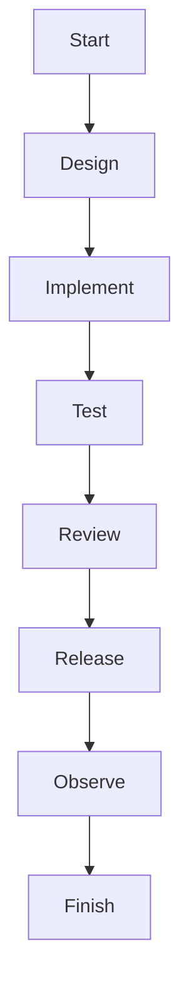

# Diagrams

[Ordinary page](./ordinary)

<DiagramSection>

## Lifecycle {#lifecycle}

Text next to the diagram.

<template #diagram>

</template>
</DiagramSection>

## Eraser

<EraserFrame title="Eraser fixture" :src="withBase('/eraser.html')" :png-src="withBase('/eraser.png')" :size="{width: 1200, height: 1800}" />

<EraserFrame title="Missing" :src="withBase('/missing.html')" :size="null">
<template #status>
Custom missing diagram status
</template>
<template #footer><a :href="withBase('/ordinary')">Custom footer</a></template>
</EraserFrame>

<DiagramFrame title="Huge" :size="{width:12000,height:18000}"><svg width="12000" height="18000" viewBox="0 0 12000 18000"><rect width="12000" height="18000" fill="white"/><text x="100" y="300" font-size="160">Huge canvas</text></svg></DiagramFrame>

Ordinary paragraph for page scrolling.

Ordinary paragraph for page scrolling.

Ordinary paragraph for page scrolling.

Ordinary paragraph for page scrolling.

Ordinary paragraph for page scrolling.

Ordinary paragraph for page scrolling.

Ordinary paragraph for page scrolling.

Ordinary paragraph for page scrolling.

Ordinary paragraph for page scrolling.

Ordinary paragraph for page scrolling.

Ordinary paragraph for page scrolling.

Ordinary paragraph for page scrolling.

Ordinary paragraph for page scrolling.

Ordinary paragraph for page scrolling.

Ordinary paragraph for page scrolling.

Ordinary paragraph for page scrolling.

Ordinary paragraph for page scrolling.

Ordinary paragraph for page scrolling.
